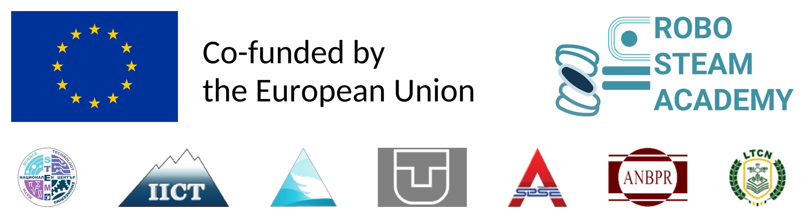

# robosteam-competition-3d-prints

**Erasmus+ project ROBO STEAM ACADEMY** (KA220-VET-7CF4F308) — co-funded by the European Union — <https://robosteam.eu/>

Part of the **PicoBot Teachers' Toolkit** (lesson plans, student materials, slides and guides in five languages):
<https://github.com/robosteamdev/robo-steam-academy-teachers-toolkit>

**3D-printable equipment for the ROBO STEAM ACADEMY robot competitions and classroom courses.** Each folder holds the
parts of one item: ready-to-print STL files, the editable source files and, where needed, a short guide. Instructions
for an item are in the `README.md` of its folder.

## Folders

| Folder | Contents |
|---|---|
| `lap_timer_box/` | enclosure for the lap timer (the infrared beam that times the competition runs), its print files and guides |
| `obstacles/` | obstacles for the obstacle courses (obstacle avoidance, Master Control) |
| `garage_cells/front_opening/` | garage cell entered **forward** (Master Control) |
| `garage_cells/side_opening/` | garage cell entered **sideways** — a mecanum-wheel move (Master Control) |
| `garbage_containers/` | containers for the garbage collection / colour sorting task (Master Control) |
| `images/` | pictures for this page |

3D-printed parts are optional: the course examples in the toolkit (A4 Experiment set-ups) also work with boxes, books
and paper cups.

## In the toolkit and the competitions

- **A4 Experiment set-ups** — the line-following track with the lap timer at the start line; the Master Control
  practice course with obstacles, garage A (forward), garage B (sideways) and the sorting bins.
- **M11** Line following (session 23, lap counting) and **M12** Capstone (sessions 25, 28 and 29: competitions,
  Master Control, race).
- Competition platform: <https://competitions.robosteam.eu/>

## Licence and credits

3D models (`.stl`), OpenSCAD source files (`.scad`), documents and pictures: **CC BY 4.0** (see `LICENSE`,
<https://creativecommons.org/licenses/by/4.0/>). You may share and adapt them, also commercially, if you credit
"ROBO STEAM ACADEMY, Erasmus+ project KA220-VET-7CF4F308" and indicate changes. The designs are independent: no
downloaded meshes are imported or copied. Third-party parts (sensor, boards) keep their own names and licences.

Funded by the European Union. Views and opinions expressed are however those of the author(s) only and do not
necessarily reflect those of the European Union or the Human Resource Development Centre (HRDC). Neither the European
Union nor the granting authority can be held responsible for them.
