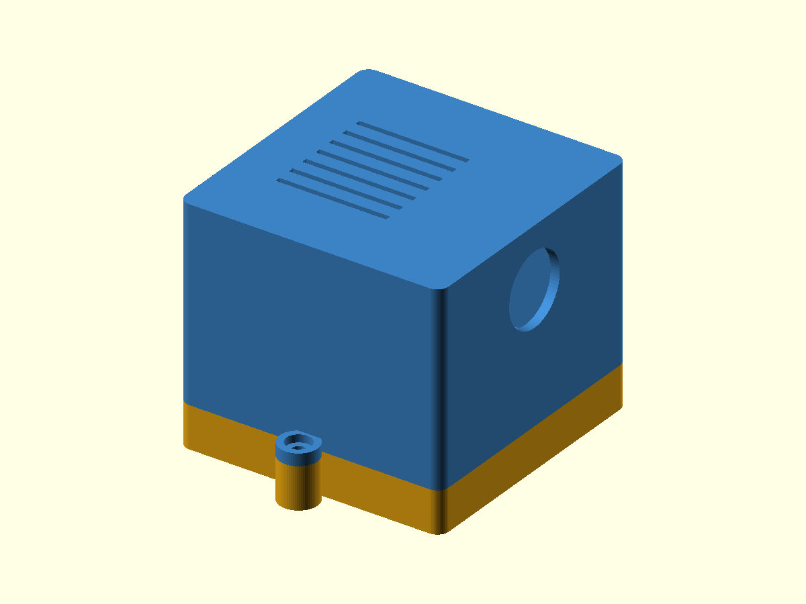

# Lap timer box

Enclosure for the RoboSTEAM lap timer: a NodeMCU (ESP8266) on its baseboard in the bottom tray and the E18-D80NK
infrared sensor (M18 thread) in the removable top. The firmware: <https://github.com/robosteamdev/robosteam-lap-timer>

| Folder | Contents |
|---|---|
| `3d_printing_files/` | STL files to print and the editable OpenSCAD source |
| `documentation/` | guides: LT1 assembly, LT2 user and set-up, LT3 troubleshooting and FAQ, LT4 parts list and print settings, LT5 engineering drawings |

**Print:** FDM, 0.4 mm nozzle, 0.2 mm layers, PLA or PETG, supports avoided where practical. Print the base with its
floor on the build plate and the top as supplied (roof down). Details: LT4 in `documentation/`.

**Test pieces first.** Print the small test pieces (PCB fit coupon, sensor-nut check, screw coupon) before the main
parts and check the fit (LT1 in `documentation/`). To change a part, open the `.scad` file in `3d_printing_files/` in OpenSCAD (<https://openscad.org>), set the line
`part = "base";` (or `"top"`, `"pcb_fit_coupon"`, `"sensor_nut_check"`, `"screw_coupon"`), render (F6) and export
the STL.

**Before you build:** the guides in `documentation/` name the version of the files and list anything that still needs
a physical check. Record every part that does not fit before changing the model. Do not connect a mains power adapter
until its voltage, polarity and current are confirmed (LT4).

**Safety:** a 3D-printer nozzle and build plate can cause burns — wait until the printer reports a safe temperature.
Do not use a cracked box near moving robots.
